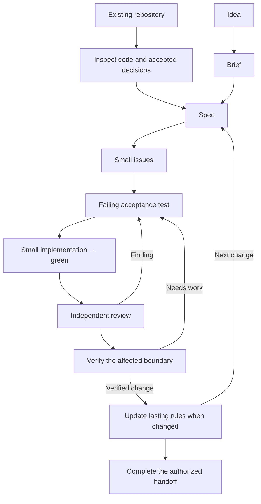

# Agentic Engineering Kit

From idea or existing codebase to scoped, tested and reviewed changes.

Practical workflows for developers using coding agents to turn an idea or an existing codebase into scoped, reviewable and verifiable software changes.

## Start here

Install the skills into your project:

```sh
npx skills add pkasarda/skills
```

Then ask your agent for the next useful step:

- **An unclear idea:** “Use product-discovery to work out the first useful flow for this idea.”
- **Project setup:** “Use agentic-bootstrap to prepare project context, a spec and issue drafts. Documentation only.”
- **A ready feature or bug:** “Use change-delivery to implement this change, test it and obtain independent review. Follow this repository's delivery procedure if it has one.”

Use the relevant step; an ordinary edit does not need the entire workflow. See installation options below for both Codex and Claude Code.

## Who this is for

- **Solo developers and small teams** moving from a prototype toward an application they can maintain.
- **Developers learning to ship with AI agents** who need to surface product, access, failure and validation decisions earlier.
- **Maintainers of established applications** onboarding agents and making bounded changes while preserving existing contracts and conventions.
- **Engineering leads coordinating agents** through specs, issues, focused context and evidence-based handoffs.

The intended users work with coding agents such as Codex and Claude Code. The skills guide the agent's work; the developer or team supplies product decisions and owns the result.

## Problems it addresses

- Vague ideas reaching implementation before the first useful user flow and its important rules are clear.
- Business rules spread across callers, with unclear ownership or inconsistent failure outcomes.
- Access checks that stop at login or button visibility instead of the resource, action, scope and fields.
- UI that works on small demo data but silently omits results or mishandles loading, errors and stale responses.
- Committed writes reported as failures, unsafe retries and external effects with no clear recovery contract.
- Green checks that prove less than claimed, and specs or backlog items that drift from accepted decisions and current code.

Use the relevant skills for the task. The kit is especially useful when establishing a project's foundations or evolving an existing system through small, verifiable slices.

## Skills

| Skill | Use it for |
| --- | --- |
| [agentic-bootstrap](skills/agentic-bootstrap/SKILL.md) | Setting up a new project or onboarding an existing repository with specs, issue handoffs and progressively disclosed instructions. |
| [product-discovery](skills/product-discovery/SKILL.md) | Shaping an unclear idea into a testable first user flow, scope and next decision. |
| [change-delivery](skills/change-delivery/SKILL.md) | Taking a scoped change through test-first implementation, independent review, fixes and verified handoff. |
| [authorization](skills/authorization/SKILL.md) | Defining and enforcing actor, action, resource and scope policy, with meaningful allow/refusal proof. |
| [robust-architecture](skills/robust-architecture/SKILL.md) | Designing or challenging ownership, boundaries, invariants and failure contracts. |
| [production-ui](skills/production-ui/SKILL.md) | Complete lists and pickers, coherent filters, realistic content and truthful asynchronous UI. |
| [safe-state-changes](skills/safe-state-changes/SKILL.md) | Implementing bounded mutations through the existing owner with scope, state and coupled-effect guards. |
| [reliable-effects](skills/reliable-effects/SKILL.md) | Recovering asynchronous delivery, retries, unknown provider outcomes and compensation. |
| [evidence-based-verification](skills/evidence-based-verification/SKILL.md) | Choosing discriminating checks and reporting what the evidence actually proves. |
| [issue-readiness](skills/issue-readiness/SKILL.md) | Reconciling issue decisions, current source, ownership, prerequisites and effective readiness. |

Each skill lives under `skills/<name>/`. Start with its `SKILL.md`; supporting references are loaded when relevant. Each can be used independently. Combine only those needed by the affected contract: a scoped picker can need `production-ui`, a changed save operation can also need `safe-state-changes`, and a claim about the result needs appropriate verification. An ordinary local edit does not need the whole library.

These are technology-neutral workflows. They use the project's actual framework, store, design system and authority rules; they do not replace platform documentation or grant permission to publish, merge, migrate or deploy. They guide decisions and checks, without guaranteeing correct architecture or production readiness on every project. Visual design remains a separate concern from data completeness and successful persistence.

## From idea to delivery

`agentic-bootstrap` prepares project context and handoffs. `change-delivery` owns the implementation loop when the project has no delivery procedure of its own. Start at the first unresolved step: a clear feature or bug can enter directly at its spec, issue or implementation.



| Transition | Relevant guidance | Concrete output |
| --- | --- | --- |
| Idea → brief | `product-discovery` | Actor, problem, first useful flow, scope, assumptions and open decisions. |
| Brief → spec | `robust-architecture`, `authorization` where needed | Intended behavior, authoritative owners, access and failure contracts, exclusions and observable acceptance. |
| Spec → small issues | `agentic-bootstrap`, `issue-readiness` | Bounded handoffs linked to the contract, with callers, acceptance, real dependencies and any activation holds. |
| Issues → implementation | `change-delivery` plus the relevant contract skills | One complete slice, with a discriminating RED → GREEN cycle for behavior changes. |
| Implementation → independent review | `change-delivery` using the project's reviewer or available review procedure | Findings checked against the contract/source, fixes or justified dispositions, and affected checks rerun. |
| Review → evidence | `evidence-based-verification`, coordinated by `change-delivery` | Executed checks at the actual affected boundary, observed outcomes and explicitly unverified guarantees. |
| Evidence → updated rules | The project's document owners, following bootstrap's disclosure guidance | Updated specs, domain/architecture/access rules and instruction pointers when the verified change establishes durable facts. |
| Verified change → handoff | `change-delivery` | The requested local result, branch/PR or separately authorized release, with an accurate completion report. |

Choose guidance by the affected contract. Access decisions can matter during design, implementation and verification. Failed checks return to implementation; a changed product decision also updates the spec. Keep temporary task notes with the issue or report, and maintain each lasting rule in one place.

Application code and tests enforce the chosen rules. The diagram describes a substantive behavior change: direct artifact checks suffice for trivial prose/config edits, and a required independent review that could not run remains unmet. Bootstrap creates only requested artifacts. Issue-ready drafts can remain held. Publishing tracker items, starting a held programme, merging or deploying follows the authority of the current request; producing a draft does not perform those actions.

### TDD, review and decisions

The kit includes a standalone delivery loop; it does not bundle a second TDD library. `change-delivery` uses the test-first procedure selected by the existing workflow, such as Matt Pocock's `tdd` or Superpowers' `test-driven-development`. Without either, it supplies the RED → GREEN loop directly. Risk procedures determine the scenarios: test-first alone cannot catch an omitted retry, access or concurrency case.

Use one delivery procedure per change. An established repository's procedure takes precedence; the kit supplies missing contract checks without starting a parallel planning/review system. Substantive changes require independent review. When an independent reviewer is unavailable, self-review is reported explicitly and does not satisfy that gate. No particular provider, model, tracker or test runner is required.

Specs state the intended behavior; ADRs preserve consequential tradeoffs. Reuse the project's domain-modeling/ADR convention, or use bootstrap's [decision guidance](skills/agentic-bootstrap/references/specs-and-issues.md#preserve-decisions-and-language). Routine local choices need no separate ADR.

Example requests in a new agent session:

- Codex: `$agentic-bootstrap Set up this new project with a first spec, issue drafts and progressively disclosed instructions. Documentation only.`
- Existing repository: `Use agentic-bootstrap to onboard this package from its current code and accepted decisions. Preserve existing rules and prepare the next bounded handoff.`
- Claude Code plugin: `/pkasarda-skills:agentic-bootstrap` followed by the repository scope and requested outcome.

## Install with `npx skills`

Requires Node.js 22.20 or later. Run from the project where you want the skills:

```sh
npx skills add pkasarda/skills
```

The interactive installer lets you choose skills and agents. To install all available skills for both Claude Code and Codex in the current project:

```sh
npx skills add pkasarda/skills --skill '*' --agent claude-code codex
```

To install only one skill:

```sh
npx skills add pkasarda/skills --skill agentic-bootstrap --agent claude-code codex
```

Add `--global` for use across projects. Preview the available skills without installing:

```sh
npx skills add pkasarda/skills --list
```

This installs standalone skills rather than the plugin package. Start a new agent session and invoke a skill, for example `$production-ui` in Codex or `/production-ui` in Claude Code. Choose this method or plugin installation for a given host to avoid duplicate skill entries. See the [skills CLI reference](https://github.com/vercel-labs/skills/blob/main/docs/commands.md).

## Install as a plugin

The repository is one skills-only plugin, `pkasarda-skills`, in the `pkasarda` marketplace. Both hosts use the same skill folders under `skills/`. It has no hooks, MCP servers or runtime dependencies. The public repository can be fetched without GitHub authentication.

### Codex

```sh
codex plugin marketplace add pkasarda/skills
codex plugin add pkasarda-skills@pkasarda
```

Start a new chat after installation. For example, ask to use `production-ui` to inspect a data-backed picker, or `robust-architecture` to assess an operation's ownership and failure contract.

To refresh the repository catalog:

```sh
codex plugin marketplace upgrade pkasarda
```

The catalog refresh and the installed plugin version are separate. After refreshing, use the Plugins page to apply an available plugin update. For the current CLI commands, see [Codex developer commands](https://learn.chatgpt.com/docs/developer-commands).

### Claude Code

Run these commands in your terminal:

```sh
claude plugin marketplace add pkasarda/skills
claude plugin install pkasarda-skills@pkasarda
```

Start a new session, then invoke a skill such as `/pkasarda-skills:production-ui` or `/pkasarda-skills:robust-architecture`.

To refresh the catalog and update the installed plugin:

```sh
claude plugin marketplace update pkasarda
claude plugin update pkasarda-skills@pkasarda
```

See [Claude Code marketplaces](https://code.claude.com/docs/en/plugin-marketplaces) for installation and [the manifest reference](https://code.claude.com/docs/en/plugins-reference) for packaging.

### Local development

With a local clone, pass its root to `codex plugin marketplace add /absolute/path/to/skills`. Claude Code can load it for one session with `claude --plugin-dir /absolute/path/to/skills`. These use the same source folders; no generated copy is needed.

The root `plugin.json` uses the portable Agent Plugins format supported by Codex. `.claude-plugin/plugin.json` provides Claude Code metadata. The two marketplace manifests point to the repository root. See [OpenAI plugin packaging](https://developers.openai.com/plugins/build/plugins) for the portable format.

Keep `name`, `version` and shared metadata aligned between plugin manifests, and bump both versions when publishing a plugin update. The plugin's package version is separate from the architecture skill's v2 evaluation history.

Use one installation method per host. Standalone copies already present in a user skills directory can appear alongside the plugin; installing this package does not remove those copies.

## Validation

See [validation scope and limits](VALIDATION.md) for the recorded structural checks and bounded reviews of additions to the library. These are not separate efficacy benchmarks. Production defect reduction has not been measured; project-specific tests and review are still needed to establish actual outcomes.

The architecture [evaluation record](skills/robust-architecture/evals/RESULTS.md) distinguishes the historical precise-task comparison, miniature repository discovery tests, the critical issue discovered there, and the targeted v2 regression/transfer checks. The v2 targeted set passed 10/12 criteria, including all 8 critical criteria; a complete paired v2 benchmark and production validation were not performed. Those results describe the frozen v2 candidate; the current entrypoint also contains an authorization-routing addition that was not part of those runs.

Evaluation fixture code intentionally contains defects. It is test input, not an implementation to copy or silently repair. Raw proposals, rubrics and failed runs are retained for inspection. Additional private-project checks are not included in this shared library.

## License

[MIT](LICENSE) © 2026 Peter Kasarda.
